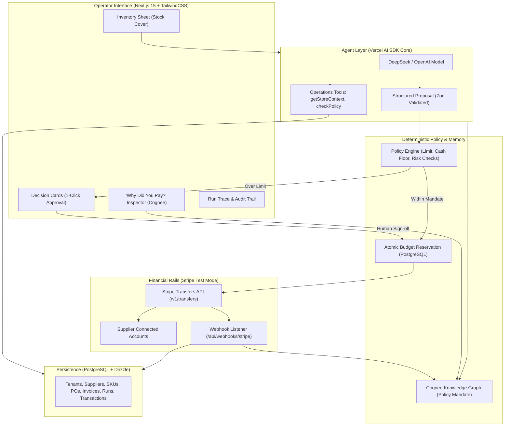
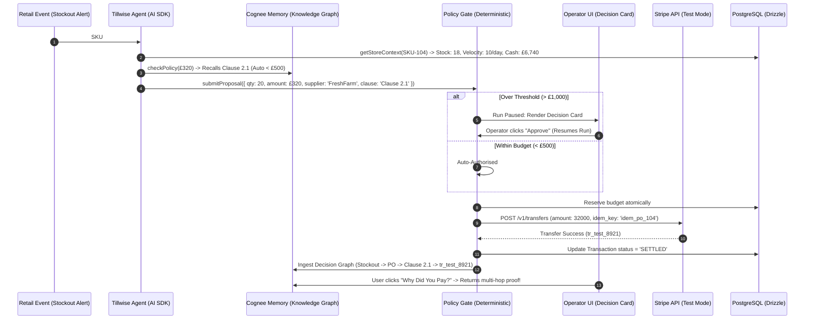

# Tillwise — Master Plan, First-Principles Architecture & Implementation Blueprint

> **Product**: Tillwise (Autonomous Retail FinOps Control Plane)  
> **Target**: Hackathon Track 01 ("Agents that spend") + Side Quest ("Best use of Cognee memory")  
> **Status**: Master Reference Document for Build & Execution

---

## 1. The Core Idea & Use Case

### 1.1 The Retail Reality (The Problem)
Retail finance is not an accounts-payable dashboard with a chatbot attached. A retail business faces two simultaneous risks:
1. **The Inventory / Revenue Risk**: If a fast-selling product stocks out, the store loses revenue, customer trust, and shelf momentum.
2. **The Liquidity & Fraud Risk**: If the store reorders recklessly, it breaches its cash floor, cannot pay operating expenses, or falls victim to vendor bank-change fraud.

A human store manager spends hours manually balancing POS reports, supplier lead times, bank balances, and paper invoices.

### 1.2 The Product Definition
**Tillwise is an autonomous retail financial control plane.**
It continuously monitors store inventory, sales velocity, supplier agreements, and cash positions. When an operational need arises (e.g. impending stockout), the agent:
- Gathers evidence using bounded read tools.
- Evaluates the merchant's written spending policy stored in **Cognee memory**.
- Proposes an authorized replenishment order.
- Passes through a **deterministic policy engine** (auto-approves if safe, pauses for approval if over limit, blocks if dangerous).
- Executes real money movement in **Stripe test mode** with idempotency keys.
- Answers the core question: ***"Why did you pay this?"*** by citing the exact clause and evidence chain from Cognee.

---

## 2. First-Principles Distillation: The 5 Layers

To prevent AI hallucinations, prompt injections, and rogue financial mutations, Tillwise enforces strict separation of five distinct layers:

```
┌─────────────────┬──────────────────────────────────┬─────────────────────────────┐
│ Layer           │ Fundamental Question             │ Component Owner             │
├─────────────────┼──────────────────────────────────┼─────────────────────────────┤
│ 1. Observation  │ What happened?                   │ POS / Webhooks / Ingestion  │
│ 2. Interpretation│ What does the evidence mean?     │ LLM Agent (Multimodal)      │
│ 3. Decision     │ What should happen?              │ Agent Proposal (Plan JSON)  │
│ 4. Authorization│ Is it permitted under policy?    │ Deterministic Policy Engine │
│ 5. Settlement   │ What actually happened to funds? │ Stripe API + Webhooks       │
└─────────────────┴──────────────────────────────────┴─────────────────────────────┘
```

**The Core Axiom**:
> *"Models may investigate, reason, and propose; but deterministic code authorizes, executes, and accounts for money movement."*

---

## 3. What We Need to Focus on First (The Thin Vertical Slice)

We do **not** build an entire ERP. We build the single undeniable causal loop that proves the central claim:

```
[ Stockout Signal on SKU #104 ]
              │
              ▼
    Agent Investigates Context (Stock: 18 units, Velocity: 10/day, Cash: £6,740)
              │
              ▼
    Queries Cognee: Matches Clause 2.1 (Auto-replenishment < £500)
              │
              ▼
    Proposes PaymentIntent for £320 to FreshFarm Produce
              │
              ▼
    Platform Policy Check: £320 < £500 limit && Cash remains > £5,000 floor ➔ AUTO-EXECUTE
              │
              ▼
    Stripe Test Transfer Executed (Live Stripe API with Idempotency Key)
              │
              ▼
    Cognee Audit Memory Ingests Causal Graph
              │
              ▼
    Judge clicks "Inspect" ➔ Cognee explains the exact rule, evidence, and Stripe ID!
```

We demonstrate **3 Distinct Scenarios**:
1. **Permitted Auto-Spend** (Autonomy): £320 order auto-executes without human intervention.
2. **Escalated Approval** (Control): £2,400 bulk order exceeds £1,000 limit; agent pauses run, renders a Decision Card, resumes upon 1-click human approval.
3. **Blocked Fraud** (Safety): Invoice with changed bank sort code triggers a hard block and cooling period.

---

## 4. The Agentic Pipeline & System Architecture

### 4.1 Two Separate Tool Planes
The agent has **no** `pay()` tool in its tool registry. It operates across two strictly isolated planes:
1. **Operations Plane (Direct Tools)**:
   - `getStoreContext(skuId)`: Reads inventory levels, daily sales velocity, preferred supplier, and current cash balance.
   - `checkPolicy(amount)`: Queries Cognee memory to identify authorizing clauses.
   - `submitProposal(plan)`: Emits the structured `PaymentIntent` proposal.
2. **Money Plane (Deterministic Execution Service)**:
   - Evaluates budget and cash floor in PostgreSQL.
   - Dispatches `stripe.transfers.create(...)` with an `Idempotency-Key`.
   - Records the settlement event in Cognee.

### 4.2 Architecture Diagram



---

## 5. End-to-End Data Flow Mapping



---

## 6. Required Stack & Package List

### 6.1 Package Matrix
| Role | Package Name | Version | Purpose |
| :--- | :--- | :--- | :--- |
| **Framework** | `next` | `15.1.3` | App Router, Server Actions, React 19 |
| **Styling** | `tailwindcss` | `^3.4.17` | Clean, modern, responsive financial dashboard |
| **Icons & UI** | `lucide-react`, `sonner`, `@radix-ui/react-dialog` | Latest | High-density status cards, toasts, modals |
| **Agent Core** | `ai` | `^4.1.0` | Vercel AI SDK Core (`generateObject`, `ToolLoopAgent`) |
| **LLM Providers** | `@ai-sdk/deepseek`, `@ai-sdk/openai` | Latest | DeepSeek (free/fast) + OpenAI fallback |
| **Memory Engine** | `@cognee/cognee-ts` | `^0.1.5` | Entity-Relationship Knowledge Graph + Vector memory |
| **Payment Rail** | `stripe` | `^17.5.0` | Node.js Stripe SDK for Transfers, Accounts, Webhooks |
| **Database & ORM**| `drizzle-orm`, `drizzle-kit`, `pg` | `^0.38.3` | Type-safe PostgreSQL queries, migrations, RLS |
| **Validation** | `zod` | `^3.24.1` | Runtime schema validation for all tools & proposals |

---

## 7. Database Schemas (Drizzle ORM)

Located at `src/lib/db/schema.ts`:
1. `tenants`: Merchant legal entity, operating currency (`GBP`), cash floor buffer (`default: 500000` = £5,000).
2. `suppliers`: Verified vendor profile, Stripe connected account ID, bank sort code & account number, cooling period flag.
3. `skus`: Inventory item, current stock, sales velocity (units/day), reorder point, preferred supplier, unit cost.
4. `purchase_orders`: Reorder quantity, total cost, status (`DRAFT`, `PLACED`, `RECEIVED`, `CLOSED`).
5. `invoices`: Inbound bill, 3-way match status (`PENDING`, `MATCHED`, `DISPUTED`, `PAID`).
6. `agent_runs`: Investigation trace, proposal plan JSON, policy decision (`AUTO`, `ESCALATE`, `BLOCK`), clause cited.
7. `transactions`: Monotonic money lifecycle (`INITIATED`, `SUBMITTED`, `PROCESSING`, `SETTLED`, `REVERSED`) with idempotency key.

---

## 8. Frontend Interface Breakdown (Origami-Style)

No generic chatbot text boxes. The UI is composed of 4 high-density, interactive views:
1. **Store Brief & Mandate Banner**: Displays live available cash, minimum protected buffer (£5,000), and policy version. Button: *"Sync Mandate with Cognee"*.
2. **Inventory Operational Sheet**: Displays SKUs with days-of-cover progress bars, stockout warning badges, and sales velocity.
3. **Decision Card Inbox**: When a run completes or pauses:
   - Displays the **Signal** (SKU #104 at 1.8 days cover).
   - Displays the **Recommendation** (20 units from FreshFarm Produce = £320).
   - Displays the **Policy Check** (Authorised under Clause 2.1 / Remaining cash £6,420).
   - Shows 1-Click **"Approve"** button (for escalated orders) or **"Auto-Executed"** badge.
4. **"Why Did You Pay This?" Audit Inspector**: Clicking any transaction opens a slide-over drawer showing the live Cognee graph traversal: Clause citation, PO match, Delivery confirmation, and Stripe Transfer ID.

---

## 9. Prerequisites & Questions Checklist for the User

To build Phase 0 and Phase 1, review this checklist:

### A. API Keys Checklist
- [ ] **LLM Key**: 
  - DeepSeek API Key from [platform.deepseek.com](https://platform.deepseek.com) (free credits) OR
  - OpenAI API Key (`sk-proj-...`).
- [ ] **Stripe Test Mode Key**:
  - `STRIPE_SECRET_KEY` (`sk_test_...`) from your Stripe Dashboard in test mode.
- [ ] **Cognee Setup**:
  - `COGNEE_API_KEY` (if using Cognee Cloud) OR we run Cognee locally via Docker/SQLite (`localhost:8000`).

### B. Database Checklist
- [ ] Do you have a local PostgreSQL instance running (e.g. `postgres://localhost:5432/tillwise`) or a hosted cloud Postgres (like Neon / Supabase / Railway)? *(If not, we can spin up local Postgres via Docker or use Neon's free tier).*

### C. GitHub Repository
- [ ] We can commit and push these architecture docs to `https://github.com/Pavan393a/Finops.git` right now!
