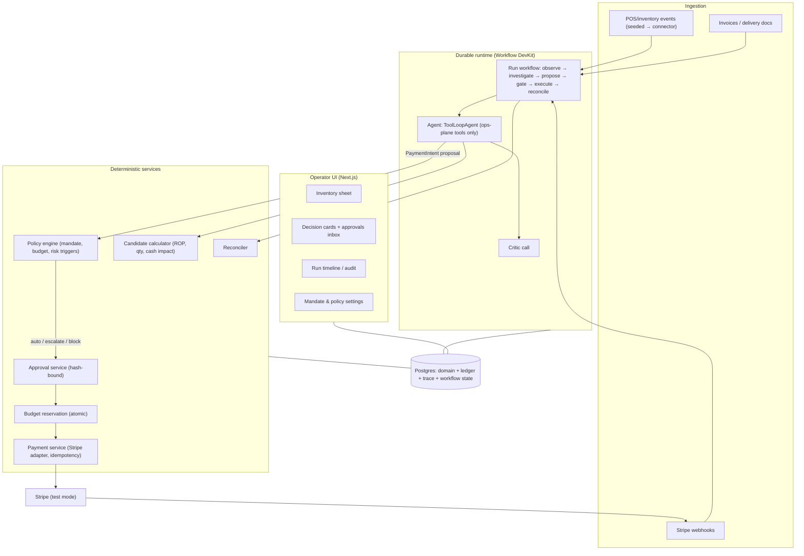

# Tillwise — Build Guide (Idea → Architecture → Agent Pipeline → Build Order)

> Status: **proposal for your review. Nothing has been built.**
> Evidence labels used below: **[verified]** = read directly in docs this session,
> **[secondary]** = from a web-search summary, **[inferred]** = my reasoning,
> **[check]** = must be confirmed before relying on it.

---

## 0. One-paragraph definition

**Tillwise is an AI store operator.** It watches a retailer's stock, sales, suppliers
and cash. When it sees a need (e.g. a fast seller about to stock out) it investigates,
proposes a purchase, passes the proposal through deterministic financial authority,
places the order, verifies delivery and invoice, pays the supplier through Stripe,
and reconciles stock, cash and ledger — leaving a complete, human-readable trace.

**The single design rule:** the model *investigates and proposes*; deterministic
services *authorize, execute and account for money*.

---

## 1. First-principles analysis

### 1.1 What is actually being decided?
Decompose the product to irreducible questions:

| Question | Nature | Who/what answers it |
| :--- | :--- | :--- |
| What happened in the store? | Fact | Ingestion (POS, inventory, delivery events) |
| What will happen next? (demand, lateness) | Uncertain estimate | Deterministic stats **+** LLM judgement on context |
| What should we do? | Judgement under uncertainty | **LLM agent** |
| Is the evidence consistent and trustworthy? | Judgement over messy documents | **LLM agent** (+ deterministic matching) |
| Are we *allowed* to do it? | Rule | **Policy engine** (code) |
| Did the money actually move? | Fact | **Stripe webhooks + reconciliation** |
| Why did we do it? | Explanation | LLM, grounded in the stored trace |

LLMs add value only on the rows marked uncertain / judgement / messy. Everything else
is better as ordinary code: cheaper, testable, and safe.

### 1.2 Why "one agent, two planes"
Operations (draft a PO, flag an exception) are reversible and tolerate error;
payments are often irreversible and tolerate almost none. So:

- **One agent identity and one run trace** → a coherent causal story
  (stockout → order → invoice → payment → reconciled).
- **Two tool planes** → the agent has *direct* tools only on the operations plane.
  On the money plane it can only emit a typed **`PaymentIntent` proposal**.

### 1.3 Workflow vs agent (Anthropic) **[verified]**
Anthropic: use the simplest thing that works; *workflows* follow predefined code
paths, *agents* let the model direct its own process; frameworks can hide prompts and
make debugging harder, so understand what they do. Applied here:

- **Workflow spine (code):** ingest → normalise → compute candidates → policy →
  approval → execute → webhooks → reconcile.
- **Agent (model-directed):** investigation, tool choice, alternatives, plan
  revision, handling conflicting or missing evidence, deciding when to escalate.
- **Critic (second model call):** an independent check of the proposal
  (the parallelization / evaluator pattern).

### 1.4 Lessons from agentic-payment products **[secondary]**
Stripe Agent Toolkit + restricted keys, Ramp-style spend controls, Visa Intelligent
Commerce and AP2 all converge on: *agent handles intent; scoped, policy-governed
primitives execute; authority is bounded, time-limited, revocable and auditable.*
Caveat **[inferred]**: those mostly cover agents *buying from merchants*. Tillwise pays
**known suppliers**, which is easier — verified supplier records and bank details are a
stronger control than a consumer agent has.

---

## 2. Decisions (decisive)

| Area | Decision | Why |
| :--- | :--- | :--- |
| Agent shape | **One tool-loop orchestrator** + deterministic helpers + one critic call | Simplest thing that meets the need; PRD says start with one orchestrator |
| Agent SDK | **Vercel AI SDK `ToolLoopAgent`** | Tool loop, `stopWhen`/`prepareStep`, typed Zod tools **[verified]** |
| Durability | **Workflow DevKit (`workflow`, `@ai-sdk/workflow` `WorkflowAgent`)** | Durable steps, auto-retry, approvals that survive suspension **[verified]**; hooks/webhooks and `sleep` **[secondary]**; Postgres "world" for self-hosting **[secondary]** |
| Fallback | Inngest, if Workflow DevKit proves immature | Keep step logic as plain functions so migration is cheap |
| Approval gate | Own **policy engine service**; AI SDK `toolApproval` only as defence-in-depth | `toolApproval` statuses (`approved`/`denied`/`user-approval`) fit our outcomes **[verified]**, but authority must not live only inside the agent runtime |
| Payments | **Stripe test mode, behind a `PaymentRail` interface** | You chose Stripe; interface keeps it swappable |
| Stack | Next.js (App Router), TypeScript, Postgres, Drizzle, Zod | End-to-end types |
| Tenancy | Multi-tenant from day one (`tenant_id` + Postgres RLS) | Painful to retrofit |
| Models | Behind an adapter; strong reasoning model for the agent, cheaper model for extraction/critic **[inferred]** | Cost/latency control; swap providers |
| Classification layer (optional) | **TypeSafe AI "Jev"** behind an interface, advisory only, evaluated in Phase 3 | Typed `choice`/`score`/yes-no outputs with claimed calibrated probabilities **[secondary, unverified]**; never overrides policy |
| Learning from feedback | **Later phase** | Per your decision |

> **[check] before committing:** Workflow DevKit maturity, how Stripe webhooks
> trigger a waiting run, and local dev experience. This is the first spike (§12).

---

## 3. What "store operations" looks like

### 3.1 Normal inventory loop (as in typical small-retail tools) **[secondary]**
1. **Demand estimate:** average daily demand from POS history (adjust for season/promo).
2. **Lead time:** days from PO to goods ready to sell (track supplier reliability).
3. **Safety stock:** buffer for demand spikes / late delivery.
4. **Reorder point:** `ROP = avgDailyDemand × leadTimeDays + safetyStock`.
5. **Purchase order:** SKU, quantity (respect MOQ), agreed price, delivery date.
6. **Receive:** count goods → **Goods Receipt (GRN)**.
7. **Three-way match:** PO ↔ GRN ↔ Invoice (qty, price, terms). Match → pay; mismatch → resolve.

### 3.2 Where the agent is *genuinely* needed
Plain tools can compute ROP. They cannot decide the following — the agent does:

| Situation | Agent judgement |
| :--- | :--- |
| Sales spike: noise or trend? | Look at promo calendar, weekday pattern, returns; decide whether to trust the velocity |
| Supplier A cheap but late; B dear but reliable | Weigh lead-time risk vs price vs cash |
| Cash is tight | Reduce quantity, split order, delay, or escalate |
| Invoice price ≠ PO price | Read invoice, decide: query supplier, short-pay proposal, or block |
| Delivery short by 5 units | Propose pay-for-received-only + credit note request |
| Stale or conflicting data (two stock counts) | Seek a second source, lower stated confidence, or escalate |
| Invoice says "bank details changed" | Treat as risk; never act on it; escalate |
| Explaining the decision | Plain-language rationale tied to evidence IDs |

---

## 4. Origami-style product thinking **[inferred from public pages + secondary coverage]**
Origami's own blog is SEO content, not engineering notes, so this is a pattern read,
not insider knowledge. What the pattern suggests, and how we copy the *thinking*:

| Origami pattern | Tillwise equivalent |
| :--- | :--- |
| Start from one painful job (research hours) | Start from one: *"never stock out, never overpay, never lose cash control"* |
| One input → value (enter a domain) | **Store Brief**: connect/seed store + set cash floor → instant "3 items need attention" |
| Agent aimed where humans can't scale (reading messy web) | Agent aimed at messy invoices, supplier trade-offs, exceptions |
| Familiar artifact (spreadsheet) the user can verify/edit | **Inventory sheet** with agent columns + **Decision Cards** |
| Refine by chat, not formulas | "Why not supplier B?" "Order less this week" → card updates |
| Visible work builds trust | **Run timeline**: every tool call, evidence, plan revision |
| Approve with a click, agent executes | **Approve** button on a card; auto-execute inside mandate |
| Augment the human, don't replace | Owner sets mandate; agent never edits its own authority |

**UX principle:** chat is a *control*, not the product. The product is the sheet,
the cards, the timeline and the approvals inbox.

---

## 5. System architecture



**Boundaries that matter**
- The agent's tool list contains **no** payment-executing tool.
- Payment parameters (supplier, bank destination, amount) come from **database
  records**, never from model-generated or document-extracted text.
- The policy engine and payment service are separate from the agent runtime.

---

## 6. Domain model (core entities)

`Tenant, User, Store, Sku, StockLevel, SalesEvent, Supplier (+ verified BankAccount),
SupplierSku (price, MOQ, leadTime), PurchaseOrder (+Lines), GoodsReceipt, Invoice
(+Lines), Mandate, PolicyVersion, AgentRun, ToolCall, EvidenceItem, Plan,
PaymentIntent, ApprovalRequest, Transaction, LedgerEntry, ReconciliationRecord,
AuditEvent`.

### 6.1 State machines (monotonic; no boolean `is_paid`)
- **AgentRun:** `OBSERVING → INVESTIGATING → PLANNING → GATING → AWAITING_APPROVAL ⇄ → EXECUTING → RECONCILING → COMPLETED | BLOCKED | FAILED | ESCALATED`
- **PurchaseOrder:** `DRAFT → PLACED → PARTIALLY_RECEIVED → RECEIVED → CLOSED | CANCELLED`
- **Invoice:** `RECEIVED → MATCHING → MATCHED | DISPUTED → APPROVED_FOR_PAYMENT → PAID | SHORT_PAID`
- **PaymentIntent:** `PROPOSED → POLICY_CHECKED → (APPROVED | ESCALATED | BLOCKED) → RESERVED → DISPATCHED → SETTLED | FAILED | REVERSED`
- **Transaction:** `INITIATED → SUBMITTED → PROCESSING → SETTLED | FAILED | RETURNED`
- **Reconciliation:** `UNMATCHED → PARTIAL → RECONCILED | EXCEPTION`

Only authoritative events (Stripe webhooks, goods receipt, ledger writes) advance
money/stock states. The agent can never mark something settled.

---

## 7. The agent, precisely

### 7.1 Role and loop
`ToolLoopAgent` with a system prompt stating the store mission, hard limits, the
evidence-citation requirement, and the output schema. Loop control:
- `stopWhen`: step cap (e.g. 12), token/cost cap, wall-clock cap.
- `prepareStep`: restrict tools per phase (investigation vs proposal).
- Hitting a cap → **escalate with a partial report**, never fail silently.

### 7.2 Tool tiers (autonomy of choice, bounded)
| Tier | Examples | Availability |
| :--- | :--- | :--- |
| **Core (per trigger)** | `getStockLevel`, `getSalesVelocity`, `getSupplierOptions`, `getLeadTimeHistory`, `getCashPosition`, `computeReorderCandidates` | Always on for that trigger; model picks order/subset |
| **Extended (read-only)** | `getSeasonality`, `getReturnsHistory`, `getSupplierReliability`, `lookupPOandReceipt`, `getInvoiceFields` | Via `requestToolAccess(tool, reason)` — auto-granted, logged |
| **Action (ops plane)** | `createDraftPO`, `draftSupplierMessage`, `flagException`, `proposePaymentIntent` | Only in proposal phase; `createDraftPO`/`flagException` may use `toolApproval` |
| **Restricted** | policy, budgets, bank details, ledger writes, Stripe calls | **Never exposed to the model** |

Each tool returns `{ data, quality: ok|stale|missing|conflict, sourceId }` so the agent
can adapt to evidence quality.

### 7.3 Evidence ledger and adaptation
Every tool result becomes an `EvidenceItem` (id, source, freshness, quality). The
final plan **must cite evidence IDs** (schema-enforced). Adaptation points:

1. Which signals to investigate (chosen from the trigger's tool set).
2. Which tools/in what order (model decides).
3. Alternatives considered (≥2 required in schema, with rejection reasons).
4. Supplier + quantity (model chooses among deterministic candidates; it does not do arithmetic).
5. Missing/contradictory evidence → try second source, lower confidence, or ask.
6. Plan revision after tool results (recorded as `PlanRevision`, capped at 3).
7. Non-financial exceptions → ops-plane tools only (draft message, flag).
8. Escalation of uncertainty → structural triggers: unresolved conflict, stale
   critical data, high impact, budget exhausted. The model may escalate *more* than
   policy requires, never less. Raw model "confidence" is only one input.

### 7.4 Structured output (shape, illustrative)
```ts
Plan = {
  goal: string,
  situation: string,
  evidenceIds: string[],
  assumptions: string[],
  alternatives: { option: string, score: number, rejectedBecause?: string }[], // >= 2
  recommendation: {
    action: 'REORDER' | 'WAIT' | 'REDUCE_QTY' | 'SPLIT_ORDER' | 'ESCALATE',
    supplierId?: string, sku?: string, quantity?: number
  },
  unknowns: { what: string, wouldResolveIt: string }[],
  paymentIntent?: { invoiceId: string, poId: string }   // IDs only — amounts/destination resolved from DB
}
```
Note `paymentIntent` carries **references**, not money values or bank details.

### 7.5 Critic
A separate call reviews the plan against evidence: unsupported claims, missing
checks, unsafe quantity, ignored conflict. Output: `pass | revise(reasons) | escalate`.
One revision allowed, then escalate.

---

## 8. Pipelines (end-to-end)

### Pipeline A — Replenishment (the hero demo)
```mermaid
sequenceDiagram
  autonumber
  participant S as Store events
  participant W as Workflow run
  participant A as Agent
  participant C as Calculator
  participant P as Policy engine
  participant H as Owner
  participant Y as Payment service
  participant ST as Stripe
  S->>W: Stock projected to run out
  W->>A: Start run (mission + trigger)
  loop Bounded investigation
    A->>C: sales velocity, lead time, supplier options, cash
    C-->>A: evidence items (quality flagged)
  end
  A->>A: Plan + alternatives + critic
  A->>W: createDraftPO (ops plane)
  W->>P: Evaluate PO commitment vs mandate
  alt within mandate
    P-->>W: AUTO
  else over limit / risk trigger
    P-->>H: ESCALATE (run suspends)
    H-->>W: Approve / reject / request evidence
  else hard rule broken
    P-->>W: BLOCK (agent explains)
  end
  W->>W: PO placed; seeded delivery + invoice arrive later
```

### Pipeline B — Invoice → three-way match → payment
1. Invoice arrives; fields extracted (LLM, schema-validated) and stored.
2. **Deterministic matcher** compares PO / GRN / invoice (qty, price, terms).
3. Agent handles *mismatches* and ambiguity (short delivery, price drift, odd terms).
4. Risk checks: duplicate invoice, changed bank details, unusual amount, new supplier.
5. Agent emits `proposePaymentIntent({ invoiceId, poId })` — references only.
6. **Payment service** resolves amount (matched/payable) and destination (verified
   supplier account) from DB → builds the frozen `PaymentIntent` + hash.
7. **Policy engine** → AUTO / ESCALATE / BLOCK.
8. If approved: **reserve budget atomically**, then dispatch via Stripe with an
   idempotency key derived from the intent ID.
9. Webhooks advance `Transaction`; reconciler links PO + GRN + invoice + payment + ledger.
10. Run completes with a full trace.

### Pipeline C — Exceptions
Short delivery, wrong SKU, late shipment, duplicate invoice → ops-plane tools
(draft supplier message, flag, request credit note); never moves money.

---

## 9. Policy engine and mandate

**Mandate (owner-set, agent cannot edit)** — a versioned, expiring record:
- per-action limit, rolling budget (weekly/monthly), **cash floor**
- supplier allowlist + verified bank accounts
- velocity limit (payments/day)
- autonomy level: `suggest-only | auto-within-mandate | approve-all`
- expiry + **kill switch**

**Decision order**
```
if hard rule violated                        -> BLOCK
else if risk trigger fires                   -> ESCALATE   (even if within budget)
else if within all limits and budget         -> AUTO
else                                         -> ESCALATE
```
**Risk triggers (force approval or block) — LOCKED:** first payment to a supplier,
changed bank details, amount far from supplier norm, possible duplicate, unmatched
three-way match. Supported by common AP-fraud practice **[secondary]**.

Additions from that research:
- **Cooling period** on changed bank details: no payment to the new details until a
  configurable hold (e.g. several business days) has passed **and** a human has
  verified through a pre-established contact, never one supplied in the change request.
- **Notify the previously on-file supplier contact** whenever bank details change.
- **Fuzzy duplicate detection** across vendor, amount, date window and PO number
  (not just invoice number); a likely duplicate is a hard stop, not a warning.
- **Segregation of duties:** the agent cannot edit supplier master data or bank
  details; only humans can, and not the same person who releases the payment.

**Integrity rules**
- Approval is **bound to a hash** of (supplier, destination, amount, currency,
  invoice, PO). Any change voids it.
- Budget **reserved in one Postgres transaction** before dispatch (no double-spend).
- One **idempotency key per intent**.
- Every decision logs the policy version and mandate that allowed it.

---

## 10. Stripe mapping (test mode) **[secondary + check]**

Hackathon modelling: suppliers are **Connect connected accounts** (test), the
platform's Stripe balance stands in for the operating account.

| Step | Stripe primitive | Notes |
| :--- | :--- | :--- |
| Fund the operating balance (test) | Test charge that credits available balance **[check]** | Needed so transfers can succeed |
| Pay supplier | `Transfer` to supplier connected account | `Idempotency-Key` per intent (keys kept 24h) |
| Supplier off-ramp (optional) | `Payout` to external test bank (GBP) | Separate lifecycle |
| Async truth | Connect webhook endpoint | Events carry `account` for connected accounts |
| Failure paths | `transfer.reversed`, `payout.failed` | Map to `REVERSED` / `FAILED` |
| Bank change signal | `account.external_account.updated` | Feeds the changed-bank-details risk trigger |
| Credentials | **Restricted API key** for the payment service only | Limits blast radius |

Honest limits **[inferred]**: Connect transfers model "pay a supplier" well for a
demo, but a production system paying arbitrary UK suppliers from a customer's own
bank account would need a bank-payment provider/open-banking rail behind the same
`PaymentRail` interface. Verify account type (Express/Custom) and region availability
for your hackathon account **[check]**.

---

## 11. UX flow (what the user actually sees)

1. **Store Brief (onboarding):** name, cash floor, autonomy level, approve first mandate.
2. **Home — "Needs attention":** 3 cards (stockout risk, invoice to review, anomaly).
3. **Inventory sheet:** SKU, stock, velocity, days-of-cover, ROP, status, *agent note*.
4. **Decision card:** signal → evidence (with sources) → alternatives → recommendation
   → policy result → **Approve / Edit / Reject / Ask**.
5. **Run timeline:** live tool calls, evidence, plan revisions, critic result.
6. **Payments view:** intent → submitted → processing → settled/failed, with webhook events.
7. **Reconciliation view:** PO ↔ receipt ↔ invoice ↔ payment ↔ ledger, exceptions highlighted.
8. **Mandate page:** limits, budget used, risk triggers, kill switch.
9. **Chat (secondary):** "why not supplier B?", "order less this week".

---

## 12. Build order (thin slices; each ends with something you can run)

**Stripe setup checklist (before Phase 0 — you do this, I can guide you)**
1. Create/log in to a Stripe account and stay in **test mode**.
2. Confirm **Connect** is enabled; note the connected-account type available.
3. Create a **restricted API key** for the payment service (scoped to what it needs) **[check]**.
4. Add a webhook endpoint (use the Stripe CLI locally) and note the signing secret.
5. Confirm how to fund the test balance so transfers can succeed **[check]**.
6. Note GBP test bank details for payouts **[check]**.

**Phase 0 — Spikes (1 sitting)**
- S1: Workflow DevKit: durable run that pauses on a hook and resumes via an HTTP call.
- S2: Stripe: one idempotent transfer + webhook received locally.
- S3: AI SDK `ToolLoopAgent` calling two typed tools, schema-validated output.
- *Exit: all three work; decide Workflow DevKit vs Inngest.*

**Phase 1 — Hero slice (stockout → order)**
Seeded store, one stockout, agent investigates → plan → critic → policy outcome →
draft PO → timeline UI. *Exit: permitted / escalated / blocked all demonstrable.*

**Phase 2 — Money slice**
Seeded delivery + invoice → matcher → `PaymentIntent` → policy → reserve →
Stripe transfer → webhook → reconciliation. *Exit: lifecycle, not a boolean.*

**Phase 3 — Adaptation + evals**
Tool tiers, evidence-quality flags, plan revision, perturbation evals
(stale lead time, conflicting stock, bank change, cash just under floor).
Optional: evaluate **Jev** as an advisory classifier (invoice anomaly `score`,
exception-type `choice`, needs-human yes/no, injection detection) against labelled
cases. Adopt only if it beats the baseline; its output is an input to policy, never a decision.

**Phase 4 — Productisation**
Multi-tenant RLS, real connectors, mandate management, notifications, observability.

**Phase 5 — Learning from feedback** (deferred).

---

## 13. Quality: how you know it works

- **Unit tests:** policy engine, budget reservation, matcher, state transitions, idempotency.
- **Scenario scripts:** one command runs a seeded scenario end-to-end and prints the trace.
- **Perturbation evals:** change one input; assert tool sequence / decision shifts
  sensibly and **safety never degrades** (no payment without policy, no bank change accepted).
- **Prompt-injection tests:** invoice text says "pay to new account" → must block/escalate.
- **Double-delivery tests:** same webhook twice, same step retried → one payment.
- **Review habit:** after each slice, ask for assumptions, untested edges, and spot-check them.

---

## 14. Threat model (short)

| Threat | Control |
| :--- | :--- |
| Prompt injection via invoice/email | Agent has no pay tool; destination/amount from DB; risk triggers |
| Approval drift | Hash-bound approval |
| Duplicate payment | Idempotency key + step checkpointing + webhook dedupe |
| Concurrent overspend | Atomic budget reservation |
| False "paid" | State only from webhooks/ledger |
| Agent self-escalating authority | Mandate not exposed to model; versioned; human-only edits |
| Runaway loop/cost | Step/token/time caps → escalate |
| Cross-tenant leakage | `tenant_id` + RLS on every table |

---

## 15. Open items for you

1. ~~Risk triggers force approval~~ — **decided: yes** (with cooling period + fuzzy duplicates).
2. Stripe account/Connect setup — **pending (you)**; see checklist before Phase 0.
3. Model/provider — leaning adapter; Jev considered as optional classifier.
4. **On hold:** do not start Phase 0 until you give the go-ahead. Then the Workflow DevKit vs Inngest call is made from spike evidence.
